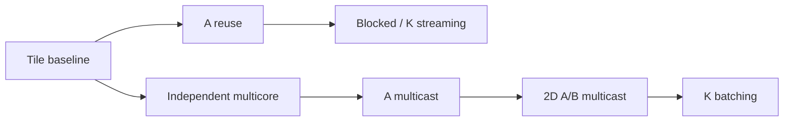

# AccelFlow

CUDA와 TT-Metalium으로 MatMul·Reduction·RMSNorm을 구현하고 데이터 이동, 재사용,
코어 간 통신과 fusion의 비용을 비교한 가속기 커널 프로젝트입니다.
CUDA는 **실제 NVIDIA MX150**, Metalium은 **TTSim의 가상 Wormhole**에서 실행했습니다.
TT-NN과 모델 실행은 후속 단계이며 현재 완료 범위에 포함하지 않습니다.

[포트폴리오 상세](docs/30-portfolio.md) · [전체 결과·TT-NN 인계](docs/29-metalium-results.md) · [실험 기록 목차](docs/README.md)

## 왜 설계를 바꿨는가

다음 표는 **같은 128×128×128 정수 입력, CB depth2**의 결과입니다.
모든 구성의 입력·출력 fingerprint가 같고 CPU FP64 기준과 오차 0으로 일치합니다.
DRAM 읽기량과 CB는 **소스 기반 모델**이며 hardware counter 측정값이 아닙니다. 단위는 KiB입니다.

| 구현 | 변경 이유와 확인한 내용 | 활성 코어 | DRAM read 모델 | CB 코어당 / 전체 |
| --- | --- | --- | --- | --- |
| [tile baseline](docs/10-matmul.md) | 출력 타일마다 A/B를 읽는 기준 경로 | 1 | 256 | 12 / 12 |
| [A reuse](docs/10-matmul.md) | 같은 A 타일을 출력 열마다 다시 읽는 요청 제거 | 1 | 160 | 16 / 16 |
| [2×2 blocked](docs/11-blocked-matmul.md) | 출력 4타일에서 A/B를 재사용하되 보관 공간 증가 | 1 | 128 | 68 / 68 |
| [독립 multicore](docs/15-independent-multicore-matmul.md) | 출력 타일을 나눠 여러 코어에 배정; 총 읽기량 유지 | 4 | 256 | 12 / 48 |
| [A multicast](docs/17-a-multicast-matmul.md) | 중복 A 읽기를 sender/receiver 전달로 대체 | 4 | 160 | 12 / 48 |
| [2D A/B multicast](docs/18-2d-multicast-matmul.md) | A는 행 방향, B는 열 방향으로 공유 | 4 | 128 | 12 / 48 |
| [2D batch4](docs/20-batched-2d-multicast-matmul.md) | K 타일 4개를 묶어 ready/data/valid 교환 감소 | 4 | 128 | 36 / 144 |

reuse/blocked와 multicore는 baseline에서 갈라진 실험입니다. 앞선 최적화를 모두 합친 한 커널의
단계별 결과는 아닙니다. blocked 재사용과 multicast의 결합은 아직 구현하지 않았습니다.



## 실제 측정과 simulator 관측

**CUDA 실측 — MX150, Windows native CUDA 12.9, FP32 저장·누적·출력.**
같은 BF16 입력값을 FP32로 확장했습니다. 시간은 GPU event로 kernel 20회를 감싼 batch 평균의
sample 중앙값을 process 3개 사이에서 다시 중앙값으로 요약한 값입니다. H2D/D2H는 제외했습니다.
단위는 ms이며 `naive/tiled`는 이 GPU와 조건 안에서 구한 비율입니다.

| M,K,N | naive | shared-memory tiled | naive/tiled |
| --- | --- | --- | --- |
| 128,128,128 | 0.08369 | 0.08890 | 0.94 |
| 320,320,320 | 1.68745 | 0.74112 | 2.28 |
| 640,320,640 | 7.62204 | 2.31803 | 3.29 |

작은 128 입력에서는 tiled가 더 느렸고 320 입력에서는 process 간 변동도 컸습니다.
재사용·접근 패턴·동기화가 함께 바뀐 실험이며 shared memory 하나의 효과로 분리하지 않습니다.
[측정 범위·trial·수치 검증](docs/21-cuda-matmul-comparison.md)

**TTSim 관측 — 가상 Wormhole, 4코어, depth2, BF16 입출력·FP32 누적.**
EnqueueMeshWorkload 직전부터 Finish 반환까지의 host 경과 시간입니다. process 3회,
각 warmup2·sample5의 중앙값을 사용했습니다. 입력 전송·readback·CPU 검증은 제외했습니다. 단위는 ms입니다.

| M,K,N | 독립 multicore | 기존 2D | batch4 | batch8 |
| --- | --- | --- | --- | --- |
| 320,320,320 | 512.976 | 1162.351 | 746.244 | 780.125 |
| 640,320,640 | 2329.654 | 4629.212 | 3241.892 | 2975.694 |

K=320의 batch4/8은 ready 신호 횟수 모델을 70%/80% 줄였습니다. 선택한 배치 설정의
host/TTSim 시간은 기존 2D보다 약 36% 줄었지만 독립 multicore보다 여전히 길었습니다.
DRAM read bytes는 batching 전후 동일합니다. CUDA와 TTSim 표 사이의 칩 속도 비율은 계산하지 않습니다.
[batch1 대조군·느린 결과·원본 표](docs/20-batched-2d-multicast-matmul.md)

## 처음 확인할 재현 경로

Linux/WSL에서 Git과 Python 3.10 이상으로 실행합니다. 기본 경로는 GPU·TTSim·PyTorch를 요구하지 않습니다.

```bash
git clone https://github.com/SangjunRyu/accelflow.git
cd accelflow
bash scripts/reproduce_portfolio.sh --evidence
```

저장된 원본 **68개**의 SHA-256, 입력·출력 fingerprint, CUDA/TTSim raw sample의 중앙값을
다시 계산해 [대표 수치 manifest](results/portfolio/20261110-public-summary/evidence.json)와 대조합니다.
`EVIDENCE_PASS`는 저장 기록의 정합성 검사이며 커널 재실행을 뜻하지 않습니다.

실제 simulator 경로는 [고정 환경 준비](docs/06-tt-metal-build-validation.md)가 끝난 뒤 실행합니다.
TT-Metal v0.79.0의 `build_Release`, TTSim v1.11.1 Wormhole, Clang 20·CMake·Ninja가 필요합니다.

```bash
bash scripts/reproduce_portfolio.sh --simulate
```

자체 MatMul host만 빌드하고 같은 64×64×96 입력으로 baseline/reuse/multicore/A multicast/2D/batch4를
총 **42회** 실행합니다. `PORTFOLIO_SMOKE_ALL_PASS`와 `results/portfolio/<UTC>/`의 명령·로그·SHA-256을 확인합니다.
의존성 설치·전체 upstream 빌드·CUDA 실행은 하지 않으며 과거 성능 표를 재측정하는 경로도 아닙니다.
[이번 대표 경로 실행 기록](results/portfolio/20261110T090405563804Z/metadata.json)

## 함께 구현한 내용과 범위

- [Reduction](docs/24-cuda-reduction.md): CUDA naive/tree/shuffle과 NPU row-wise sum, 공통 입력 대조.
- [RMSNorm fusion](docs/26-npu-rmsnorm-fusion.md): 중간 DRAM을 L1 CB로 옮기고 기존 출력·PyTorch와 대조.
- [행·열 분할 RMSNorm](docs/28-column-sharded-rmsnorm.md): 독립 행 분할과 부분합 gather/전체 합 전달 비교.
  행·열 49개 구성의 PyTorch 대조와 보조 검증 포함 76회 연산 실행을 통과했습니다.

TTSim 시간은 실물 NPU latency·TOPS가 아닙니다. payload 모델은 cache hit·NoC stall·실제 bandwidth를
측정하지 않습니다. nvprof counter 수집 실패로 shared-memory bank conflict도 정량 검증하지 못했습니다.
[측정 정책](docs/92-measurement-policy.md), [profiler 진단](docs/23-texture-matmul-and-profiler.md).

자체 코드는 `npu/`, `cuda/`, 재현 도구는 `scripts/`, `tools/report/`, 실험 근거는 `results/`에 있습니다.
외부 TT-Metal 소스·TTSim binary·빌드 산출물은 Git에서 제외했습니다.
전체 계획은 [프로젝트 명세](AccelFlow_PROJECT.md), 라이선스 상태는 [LICENSE](LICENSE)를 참고하세요.

별도 정밀도 실험은 [31. FP32-to-Dest RMSNorm](docs/31-fp32-to-dest-rmsnorm.md)에 정리했습니다. 순정 경로의 실패와 로컬 LLK 호환 처리 후 비트 분할 없는 FP32 계산을 구분합니다.

RMSNorm split/FP32-to-Dest의 같은 3-stage 반복 시간 비교와 측정 한계는 [32번](docs/32-rmsnorm-fp32-dest-timing.md)에 기록했습니다.
