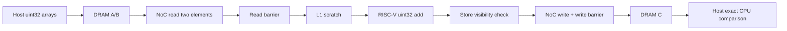
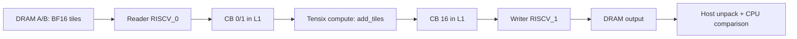

# 08. 자체 Vector Add 구현·검증 — Phase 1

상태: **완료**. 2026-10-06 가상 Wormhole에서 자체 host 프로그램과 커널을 실행했습니다.
[진행 순서](README.md) · 이전: [07. WSL 작업 공간 이동](07-wsl-workspace-migration.md)

## 진행 단계와 결과

| 단계 | 수행한 작업 | 결과 |
| --- | --- | --- |
| V0 | 공식 두 정수 예제의 host/NoC/L1/동기화 흐름 분석 | 06번에서 결과 21 확인 |
| V1 | AccelFlow 자체 uint32 배열 덧셈 | 9개 케이스 exact PASS |
| V2 | BF16 reader/compute/writer 및 Circular Buffer 구성 | 12개 케이스 PASS |
| 검증 | 난수·0·음수·경계 길이·unsigned wrap·tail padding | 모두 PASS |

고정 실행 환경은 TT-Metal v0.79.0 / TTSim v1.11.1 / virtual Wormhole / Clang 20.1.2입니다.
uint32 길이 1, 4, 31, 32, 33, 1024, 1025를 검사했습니다.
BF16 길이 1, 4, 31, 32, 33, 1023, 1024, 1025, 2048, 2051을 검사했습니다.
난수 seed는 2026이며, 작은 입력 `[1,2,3,4] + [5,6,7,8]`의 기대 결과는 `[6,8,10,12]`입니다.

## V1 — RISC-V 배열 덧셈

host는 입력/출력 DRAM buffer 3개를 만들고 입력을 command queue로 전송합니다.
각 원소를 4-byte page로 취급하므로 `InterleavedAddrGen`이 page index로 DRAM bank 주소를 계산합니다.
L1 scratch buffer 3개는 각 4-byte 논리 데이터를 재사용합니다.



각 원소에 read barrier, `load_blocking` store visibility 검사, write barrier가 있습니다.
RISC-V store와 NoC의 L1 접근은 독립적인 경로이므로 이 순서가 중요합니다.
CPU 비교는 uint32의 정의된 modulo 2^32 덧셈을 사용합니다. MAX 값의 wrap도 검증했습니다.
이 구현은 실행 이해를 위한 baseline이며 원소마다 전송·동기화를 수행합니다.

N개 원소의 **요청 payload**는 DRAM read `8N` bytes, write `4N` bytes입니다.
페이지 stride, bus transaction 및 allocator alignment 비용은 이 수치에 포함하지 않습니다.
L1의 12 bytes 역시 논리 scratch 데이터 크기이며 실제 allocator 점유량이 아닙니다.

## V2 — 타일 reader / compute / writer

host에서 1D 입력을 32×32 타일로 나누고 마지막 타일을 zero padding합니다.
32×32 row-major logical tile을 네 개의 16×16 face 순서로 pack하며 출력은 동일 매핑으로 읽습니다.
이 단계는 1D elementwise 연산이며 행렬 연산·layout conversion 성능 검증은 아닙니다.



reader와 writer는 고정 공식 예제에서 확인한 `TensorAccessor`와 NoC API를 사용합니다.
reader는 CB 공간을 reserve하고 전송 완료 후 push합니다. compute는 두 입력을 wait하고,
tile register를 acquire/commit/wait해 덧셈 결과를 pack합니다. writer는 결과를 wait하고
DRAM 쓰기 완료 후 pop합니다. 따라서 아직 사용 중인 CB 슬롯을 덮어쓰지 않습니다.

한 Tensix core `(0,0)`에서 세 커널을 사용합니다. CB 3개는 각 두 타일을 저장합니다.
한 BF16 타일은 1024개 원소 / 2048 bytes, CB 논리 총 용량은 **12,288 bytes**입니다.
타일 수 T에 대한 DRAM payload는 read `4096T`, write `2048T` bytes입니다.
CB depth 2는 producer/consumer를 분리할 공간을 제공하지만, 실물 overlap이나 speedup을 측정한 것은 아닙니다.

## 정확성 기준

- uint32: 모든 원소 exact, modulo 2^32. 음수는 이 variant의 입력 범위가 아닙니다.
- BF16 작은 정수/0: exact. 양·음수 입력과 cancellation을 포함합니다.
- BF16 소수: **양자화된 BF16 입력을 FP32로 더한 값**을 기준으로 비교합니다.
  `abs_error <= 0.008 + 0.008 * abs(reference)`를 요구합니다.
- max/mean absolute error와 max relative error를 JSON으로 기록합니다.
  relative denominator는 `max(abs(reference), 1e-6)`입니다.
- 2051개 소수 입력에서 관측한 max absolute error는 **0.00390625**였습니다.
- 패딩 원소는 출력까지 모두 0인지 검사했습니다. 결과 길이도 검사합니다.

두 variant는 서로 다른 자료형과 연산 엔진을 사용하므로 성능·정밀도 직접 비교를 하지 않습니다.
임의의 float 범위·NaN/Inf·다중 코어·빈 입력·모든 TT-NN 연산은 아직 검증하지 않았습니다.
이 테스트 harness는 0개 입력을 거부합니다.

## 실행 방법과 파일

```bash
cd /home/ysjun5656/dev/accelflow
bash scripts/run_vector_add.sh
```

- host: `npu/vector_add/vector_add_riscv.cpp`, `vector_add_tiled.cpp`
- 장치: `npu/vector_add/kernels/`의 네 소스
- 실행 파일: `build/vector_add/vector_add_riscv`, `vector_add_tiled`
- 실행 로그: `results/vector_add/<UTC>/riscv.log`, `tiled.log`
- 결과: 각 variant JSON + 버전/OS/compiler/source hash를 기록한 `metadata.json`
- 구조 지표는 코드 기반 계산값이며 profiler의 실측 hardware counter가 아닙니다.

프로젝트는 아직 Git repository가 아니므로 project git commit은 null로 기록하고 source SHA-256을 기록합니다.
기존 shared libraries를 재사용하며 upstream 전체 재빌드를 하지 않습니다.

## 외부 프로젝트 연동에서 확인한 사항

고정 build-tree의 official example compile command에서 include/define을 추출해 외부 CMake target에 연결했습니다.
이 build-tree adapter는 v0.79.0의 이미 빌드된 라이브러리 경로에 한정됩니다.
버퍼의 host `DeviceAddr`는 64-bit이고 runtime args는 32-bit이므로 범위 검사 후 변환합니다.
외부 프로젝트 cwd에서는 `TT_METAL_HOME`만으로 runtime root를 정하지 못했습니다.
고정 `tt_metal/llrt/rtoptions.cpp`에 정의된 **`TT_METAL_RUNTIME_ROOT`**를 사용해 해결했습니다.
원본 upstream source/버전/빌드 설정은 수정하지 않았습니다.

공식 API 근거와 라이선스 출처는 [Vector Add README](../npu/vector_add/README.md)에 있습니다.
simulator 출력 시간은 실제 NPU latency/throughput으로 보고하지 않습니다.

다음 단계는 **Phase 2: MatMul baseline과 tile decomposition**입니다.

## 최종 실행 증거

- [metadata.json](../results/vector_add/20261006T104501984062Z/metadata.json)
- [riscv.json](../results/vector_add/20261006T104501984062Z/riscv.json)
- [riscv.log](../results/vector_add/20261006T104501984062Z/riscv.log)
- [tiled.json](../results/vector_add/20261006T104501984062Z/tiled.json)
- [tiled.log](../results/vector_add/20261006T104501984062Z/tiled.log)

두 executable exit code 0, 총 21개 케이스 PASS입니다.

## 설계 평가 보강

후속 [09. 설계·성능 구조 평가](09-vector-add-design-assessment.md)에서 동일 BF16 입력의
CB depth 1/2, 65타일 슬롯 재사용, runtime buffer 정렬 관측을 추가했습니다.
현재 runner는 uint32 10개와 BF16 depth 1/2 각각 14개, 총 38개를 검증합니다.
위의 21개 검증과 0.00390625 오차는 최초 실행 기록입니다.

후속 완료: [10. MatMul 구현·평가](10-matmul.md)에서 타일 baseline과 A 행 재사용을 검증했습니다.
