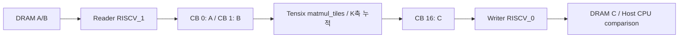

# 10. 타일 MatMul 구현·재사용 평가 — Phase 2

상태: **MatMul 첫 구현과 구조 최적화 검증 완료**. 2026-10-06 가상 Wormhole에서 실행했습니다.
[진행 순서](README.md) · 이전: [09. Vector Add 설계 평가](09-vector-add-design-assessment.md)

## 구현한 것

`A(M,K) × B(K,N) → C(M,N)`을 BF16 tile로 실행하는 자체 host/reader/compute/writer를 만들었습니다.
기존 TT-Metal v0.79.0 / TTSim v1.11.1 / Clang 20.1.2 / SFPI 7.78.0을 재사용했습니다.
전체 upstream stack은 재빌드하지 않았고 원본 소스/빌드 설정은 변경하지 않았습니다.

| 버전 | 구현·검증 |
| --- | --- |
| V0 CPU reference | BF16으로 양자화된 입력의 곱을 FP64로 누적 |
| V1 tile baseline | 출력 타일마다 A/B를 읽고 K 타일 축을 누적 |
| V2 A 행 재사용 | A의 한 tile row를 L1/CB에 유지해 N 출력 열에서 재사용 |
| buffering 실험 | 각 버전에서 streaming CB depth 1/2 비교 |

여기서 baseline도 이미 타일 기반입니다. 데이터 이동 이해를 위한 원소별 naive MatMul은 만들지 않았습니다.
CUDA 실측 비교·다중 코어·전체 GEMM 최적화는 이 단계에 포함하지 않았습니다.

## 실제 테스트 결과

baseline/depth1, baseline/depth2, reuse_a/depth1, reuse_a/depth2를 각각 12개 입력으로 검증해
**48개 케이스 모두 PASS, 네 executable 실행 모두 exit code 0**입니다.
네 설정의 입력 fingerprint와 출력 fingerprint가 모두 일치합니다.

| 입력 종류 | M,K,N | 확인 목적 |
| --- | --- | --- |
| 결정적 예제 | 2,3,2 | 기대 C = `[[58,64],[139,154]]` |
| A=0 | 33,35,31 | zero output과 padding |
| A=identity | 32,32,32 | B 그대로 복원 |
| signed integer random | 32,32,32; 31,33,35; 33,31,65 | 음수·비정방형·타일 경계 |
| signed integer random | 64,64,96 | 여러 출력 타일 및 A 재사용 |
| signed integer random | 32,128,96; 65,97,33 | Kt=4 누적·A 보관 용량·출력 CB 재사용 |
| 소수 random | 32,64,64; 33,35,65 | BF16 수치 오차 |
| 큰 representable 값 | 8,16,8, A=B=8 | 기대값 1024의 안전한 exact 계산 |

signed random 입력은 -1/0/1입니다. 이 fixture와 결정적·identity·zero·큰 representable 값은
모든 원소 exact 비교를 요구했습니다. 소수 입력은 범위 [-0.5,0.5]이며
`abs_error <= 0.03 + 0.03 * abs(reference)`를 사전에 지정했습니다.
이는 이 초기 BF16 fixture의 검증 기준이며 모든 크기·입력 범위에 대한 오차 보장은 아닙니다.
소수 케이스 max absolute error는 각각 **0.0240031**, **0.0135797**이었고 네 설정에서 같습니다.
max/mean absolute 및 max relative error도 JSON에 기록합니다. relative denominator floor는 1e-6입니다.

출력 DRAM을 처음에 NaN sentinel로 채운 뒤 **모든 padded output**이 유한한 계산 결과로
덮어써졌는지 검사했습니다. padding 영역은 모두 0이어야 하므로 쓰지 않은 영역이 우연히 0으로
남아 검증을 통과하는 것을 방지합니다.

## 타일·행렬 배치

M/K/N을 각각 32배수로 padding합니다. 한 타일은 32×32 BF16 / 2048 bytes입니다.
타일 행렬은 tile row-major 순서이고, 각 타일 내부는 네 개의 16×16 face 순서로 저장합니다.
자체 packing 결과를 **공식 `tilize_nfaces` 결과와 비교**해 모든 입력에서 layout 일치를 확인했습니다.

`Mt=ceil(M/32)`, `Kt=ceil(K/32)`, `Nt=ceil(N/32)`로 정의하면:

```text
A tile(m,k) → index m*Kt+k
B tile(k,n) → index k*Nt+n
C tile(m,n) → index m*Nt+n
```

Vector Add와 달리 MatMul은 실제 row/column 의미가 중요합니다. 출력은 동일 face mapping으로
복원하고 CPU row-major reference와 원소별 비교합니다. 단순 tile 배열의 순서만 맞는지 검사한 것이 아닙니다.

## 커널 흐름



compute는 공식 예제의 `compute_kernel_hw_startup<SrcOrder::Reverse>`와 `matmul_init`을 사용합니다.
출력 타일마다 tile registers를 acquire하고 Kt번 `matmul_tiles`를 누적한 뒤 commit/wait/pack합니다.
출력 CB를 reserve/push해 writer에 넘기고 writer는 DRAM 쓰기 완료 후 pop합니다.
HiFi4를 사용하며 host의 shape는 runtime args로 전달합니다. 재사용 모드는 compute compile arg로 선택합니다.

## 최적화 사례 — 반복 A tile load 제거

**문제:** baseline의 m/n/k 루프는 같은 A(m,k)를 n마다 다시 읽습니다.

**변경:** reuse_a reader는 m마다 Kt개의 A 타일을 읽고 CB 0에 유지합니다.
compute는 해당 A 타일들을 index k로 참조하며, 모든 n 출력이 끝난 후에만 Kt개를 pop합니다.
reader의 다음 A 행 reserve는 이 소비 완료를 기다립니다. B는 이전처럼 k/n 순서로 streaming합니다.

**평가:** 동일 BF16 입력과 출력, 같은 math fidelity/core/kernel 구조에서 재사용 여부만 바꿨습니다.
output fingerprint는 네 설정에서 일치하며 CPU 비교·NaN sentinel·padding 검사도 통과했습니다.
같은 입력 여부의 FNV-1a fingerprint는 동일성 대조용이며 보안 hash가 아닙니다. 소스는 SHA-256으로 기록합니다.

다음 수치는 소스의 루프와 shape에 기반한 **구조 모델**이며 runtime DRAM counter는 아닙니다.

| 항목 | baseline | reuse_a |
| --- | --- | --- |
| A tile reads | Mt×Nt×Kt | Mt×Kt |
| B tile reads | Mt×Nt×Kt | 동일 |
| C tile writes | Mt×Nt | 동일 |
| read payload bytes | 4096×Mt×Nt×Kt | 2048×(Mt×Kt + Mt×Nt×Kt) |
| matmul_tiles calls | Mt×Nt×Kt | 동일 |
| NoC read barrier calls | 2×Mt×Nt×Kt | Mt + Mt×Nt×Kt |

M=64,K=64,N=96에서 Mt=2,Kt=2,Nt=3입니다:

| 지표 | baseline | reuse_a |
| --- | --- | --- |
| A tile reads | 12 | 4 |
| B tile reads | 12 | 12 |
| read payload | 49,152 bytes | 32,768 bytes |
| write payload | 12,288 bytes | 12,288 bytes |
| CB capacity (depth2) | 12KiB | 12KiB |

**입력 read payload 모델은 33.3% 감소**합니다. write까지 포함한 총 payload 모델은 약 26.7% 감소입니다.
이를 실물 latency 33.3% 향상으로 해석하지 않습니다. 실제 transaction 수·bandwidth·stall은 미측정입니다.
Nt=1에서는 A load 감소가 없고, B의 반복 load는 이 버전에서도 남아 있습니다.

## 재사용과 메모리 비용

baseline CB 용량은 각각 depth tiles입니다. reuse_a는 CB 0에 Kt tiles가 필요하고
CB 1/16에 depth tiles를 사용하므로 총 구성 용량은 `2048×(Kt+2×depth)` bytes입니다.

K=128(Kt=4), depth2에서는 **12KiB → 16KiB**가 됩니다.
즉 A 재사용이 늘어날수록 더 큰 local storage를 요구합니다. 지원하는 Kt 범위를 무한히 확장한 구현은 아닙니다.
현재 fixture의 Kt 최대는 4입니다. CB 크기는 configured payload capacity이며 전체 core L1 사용량이 아닙니다.
runtime DRAM buffer의 logical/aligned/page/per-bank 크기는 결과 JSON에서 따로 확인합니다.

depth 1/2는 baseline 전체 streaming CB와 reuse_a의 B/output streaming CB에 적용됩니다.
reuse A 용량은 Kt로 고정됩니다. depth2는 다음 타일을 준비할 여유를 제공하지만,
**실제 시간상 overlap이나 speedup은 아직 입증하지 않았습니다.**

## padding·유효 연산량

모델상 useful FLOPs는 `2MKN`, padded FLOPs는 `2MpKpNp`입니다. 이 수치는 처리율 측정이 아닙니다.
2×3와 3×2의 곱도 장치에서는 32×32 타일을 사용하므로 padding 비용이 큽니다.
정방형 32배수 입력과 작은/비정방형 입력을 분리해 평가해야 합니다.

## 재현·증거

```bash
cd /home/ysjun5656/dev/accelflow
bash scripts/run_matmul.sh
```

- host 및 자체 커널: `npu/matmul/`
- executable: `build/matmul/matmul`
- [메타데이터](../results/matmul/20261006T111419212534Z/metadata.json)
- [baseline depth1](../results/matmul/20261006T111419212534Z/baseline_depth1.json)
- [baseline depth2](../results/matmul/20261006T111419212534Z/baseline_depth2.json)
- [reuse depth1](../results/matmul/20261006T111419212534Z/reuse_a_depth1.json)
- [reuse depth2](../results/matmul/20261006T111419212534Z/reuse_a_depth2.json)
- [비교·평가 JSON](../results/matmul/20261006T111419212534Z/design-assessment.json)
- [자동 생성 구조 표](../results/matmul/20261006T111419212534Z/design-assessment.md)

같은 폴더의 `.log`에 전체 실행 출력과 exit code가 있습니다. compiler/OS/kernel/버전/source hash도 저장했습니다.
프로젝트 Git commit은 아직 없으므로 null입니다. 원본 API 근거는 [MatMul README](../npu/matmul/README.md)에 있습니다.

## 남은 단계

동일 데이터형의 B 재사용/blocked MatMul, local memory budget 확대 시 안전한 범위 검증,
실물 또는 CUDA 실측 비교, multi-core 분할이 남아 있습니다. 모든 크기·dtype·NaN/Inf·overflow에 대한
일반적인 GEMM 정확성을 주장하지 않습니다. 기존 Vector Add를 함께 유지하며 향후 reduction/RMSNorm으로 연결합니다.

후속 완료: [11. Blocked MatMul](11-blocked-matmul.md)에서 A/B 재사용, 출력 타일 네 개 누적, 홀수 블록 경계, 세 모드×depth 1/2의 84개 검증을 완료했습니다. 본 문서의 48개 결과는 첫 구현 당시의 기록입니다.
