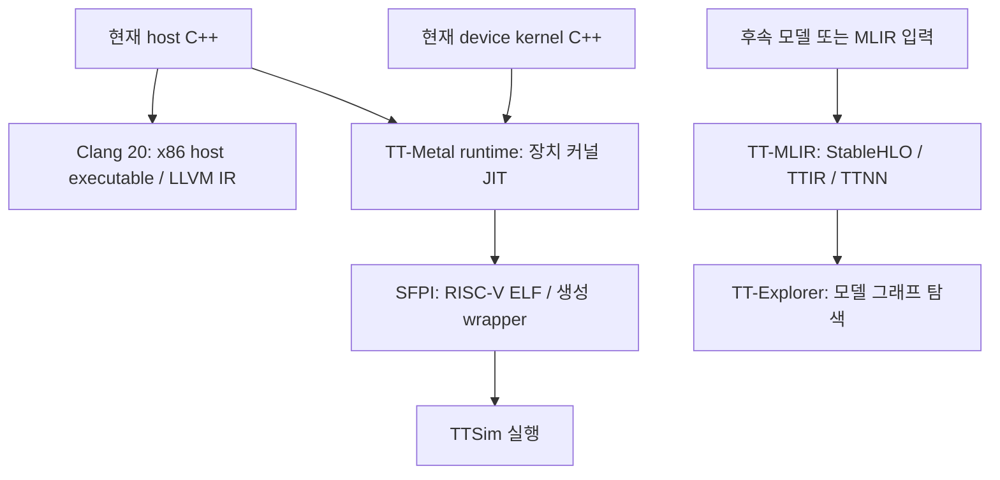

# 14. 컴파일 관찰 환경과 TT-Explorer 적용 범위

상태: **현재 TT-Metal C++의 컴파일 관찰 환경 구성·실제 산출물 검증 완료**.
TT-Explorer/TT-MLIR 전체는 설치하지 않았습니다. 조사 날짜: 2026-10-07.
[진행 순서](README.md) · 이전: [13. 실행 비용 측정](13-matmul-simulator-performance.md)

## 현재 프로젝트에서 사용할 수 있는가

TT-Explorer를 후속 모델 컴파일 학습 단계에 추가할 수 있습니다.
다만 현재 작성한 TT-Metal host/kernel C++를 곧바로 TT-Explorer에 넣는 방식은 아닙니다.
공식 설명에서 TT-Explorer의 입력은 TT-MLIR이 생성한 MLIR이고,
StableHLO/TTIR/TTNN 단계의 연산·속성·모델 그래프를 탐색합니다.
[공식 TT-Explorer 문서](https://docs.tenstorrent.com/tt-mlir/tt-explorer/tt-explorer.html)

현재 MatMul의 타일링·CB 배치·커널 분할은 우리가 C++로 직접 작성했습니다.
이 경로를 실행한다고 TT-MLIR의 그래프나 lowering pass 기록이 생성되는 것은 아닙니다.
기존 C++ 구현을 자동으로 TTIR로 역변환하는 연결은 이번 조사에서 확인하지 못했습니다.



host LLVM IR과 TTIR/TTNN은 서로 다른 것입니다. Host IR은 CPU에서 실행할 host 코드의 표현이며
Tensix의 타일 배치 계획이나 모델 그래프를 대신 나타내지 않습니다.

## 이번에 구성한 실제 관찰 도구

이미 설치된 Clang/CMake와 TT-Metal의 SFPI 도구를 사용했습니다.
추가 패키지·드라이버·firmware 설치나 upstream 변경은 하지 않았습니다.

| 도구·산출물 | 볼 수 있는 내용 |
| --- | --- |
| CMake `compile_commands.json` | host의 compiler, include 경로, defines, 최적화 옵션 |
| Clang `-S -emit-llvm` | 실제 host MatMul 코드의 최적화된 LLVM IR |
| SFPI `riscv-tt-elf-objdump -d -C` | 장치 RISC-V ELF의 disassembly |
| SFPI `riscv-tt-elf-nm -C --defined-only` | 장치 ELF의 심볼과 주소 |
| SFPI `riscv-tt-elf-readelf -h -S -s` | ELF architecture, section, symbol table |
| SFPI `riscv-tt-elf-size -A` | 섹션별 크기; 전체 파일 크기와 구분 |
| JIT 생성 `chlkc_*.cpp`/header | 같은 compute C++가 unpack/math/pack wrapper로 분리되는 모습 |

새 스크립트는 프로젝트 MatMul build에서 compile database를 내보내고 host IR을 생성합니다.
이미 생성된 JIT cache는 읽기 전용으로 검사해 ELF와 wrapper를 결과 폴더에 복사합니다.
현재 실행과 관계없이 cache에 여러 hash/config가 있을 수 있으므로 모든 선택 hash와 경로를 기록합니다.
cache ELF를 현재 소스와 정확히 일치한다고 단정하는 대신 원본 경로·hash·SHA-256을 보존합니다.

## 실제 검증 결과와 읽는 순서

streamed MatMul에서 **host LLVM IR 생성 및 장치 ELF 5개 검사 모두 성공**했습니다.

| Processor | 역할 | 읽을 파일 |
| --- | --- | --- |
| NCRISC | reader: DRAM→입력 CB | reader_streamed의 assembly/symbols |
| TRISC0 | compute unpack | chlkc_unpack.cpp, trisc0 ELF |
| TRISC1 | compute math | chlkc_math.cpp, trisc1 ELF |
| TRISC2 | compute pack | chlkc_pack.cpp, trisc2 ELF |
| BRISC | writer: 출력 CB→DRAM | writer_blocked의 assembly/symbols |

추천 순서는 다음과 같습니다.

1. `npu/matmul/kernels/compute_streamed.cpp`에서 K chunk/CB/누적 구조를 읽습니다.
2. 복사된 `chlkc_math.cpp`에서 `TRISC_MATH`와 원본 커널 include를 확인합니다.
3. `symbols.txt`에서 kernel 관련 함수 이름과 주소를 찾습니다.
4. `assembly.txt`에서 해당 주소의 명령을 읽습니다.
5. `sections.txt`에서 `.text`와 기타 섹션 크기를 구분합니다.
6. Host `compile_commands.json`에서 host와 장치가 서로 다른 compiler 경로임을 확인합니다.

코드가 최적화·인라인되므로 C++ 한 줄과 assembly 한 줄이 일대일로 대응하지 않습니다.
전체 ELF 파일 bytes에는 debug/symbol 등도 포함될 수 있어 그대로 장치 코드 용량으로 보지 않습니다.
이번 구성은 정적 산출물 관찰이며 TTSim에서 breakpoint/single-step 디버깅을 검증한 것은 아닙니다.
어셈블리 개수와 시뮬레이터 시간을 실제 장치 cycle/TOPS로 환산하지 않습니다.

- [전체 artifact 목록](../results/compile_inspection/20261007T113526067143Z/README.md)
- [원본 경로·hash·검사 명령](../results/compile_inspection/20261007T113526067143Z/manifest.json)
- [host compile database](../results/compile_inspection/20261007T113526067143Z/host/compile_commands.json)
- [host LLVM IR](../results/compile_inspection/20261007T113526067143Z/host/matmul-host.ll)

## 재현 명령

```bash
cd /home/ysjun5656/dev/accelflow
bash scripts/inspect_compilation.sh
bash scripts/inspect_compilation.sh --variant blocked
bash scripts/inspect_compilation.sh --variant baseline
```

첫 명령은 실제 실행 검증했고 나머지는 같은 도구의 선택 옵션입니다.
해당 커널이 JIT cache에 없다면 먼저 `bash scripts/run_matmul.sh`로 생성합니다.
스크립트는 `results/compile_inspection/<UTC>/README.md`와 `manifest.json`을 생성합니다.
복사 대상 ELF의 합이 20MiB를 넘으면 범위를 줄이도록 중단합니다.
이 제한은 전체 텍스트 보고서 용량의 상한을 의미하지 않습니다.

VS Code에서 host 빌드 설정을 확인하려면 `build/matmul/compile_commands.json`을 열 수 있습니다.
별도 C++ 언어 서버 확장 설치·설정은 이번 작업에 포함하지 않았습니다.

## TT-Explorer 설치가 별도 단계인 이유

공식 Quick Start는 TT-MLIR 환경을 준비하고 runtime/perf/debug/StableHLO를 활성화한 후
`explorer` target을 빌드하는 경로를 제시합니다. 환경 구성에는 LLVM/FlatBuffers/Python과
runtime를 위한 TT-Metal/TTNN 의존성이 추가됩니다.
[공식 설치 절차](https://docs.tenstorrent.com/tt-mlir/getting-started.html)

현재 C: 여유 약 19.8GiB, WSL RAM 3.8GiB에서 추가 toolchain/TTNN/runtime의 실제 공간 예산을
확인하지 않고 전체 빌드를 진행하지 않았습니다. 공식 문서만으로 정확한 추가 GiB를 확정할 수 없습니다.
현재 설치 안내는 Clang 14~18/Python 3.12를 명시하고, 우리 host build는 Clang 20을 사용합니다.
TT-MLIR revision과 그 revision의 TT-Metal/TTNN 의존성을 고른 뒤 별도 환경에서 맞춰야 합니다.
현재 v0.79.0 build tree를 최신 TT-MLIR runtime에 그대로 연결하는 호환성은 검증하지 않았습니다.

아래는 **공식 문서에 제시된 빌드 형태를 기록한 것이며 이번에 실행한 명령이 아닙니다.**
TT-MLIR clone·toolchain 준비와 자원/호환성 검토 이후 적용해야 합니다.

```bash
source env/activate
cmake -G Ninja -B build \
  -DTT_RUNTIME_ENABLE_PERF_TRACE=ON \
  -DTTMLIR_ENABLE_RUNTIME=ON \
  -DTT_RUNTIME_DEBUG=ON \
  -DTTMLIR_ENABLE_STABLEHLO=ON
cmake --build build -- explorer
tt-explorer
```

설치 후에는 별도 MatMul 모델/MLIR를 만들어 단계별 IR을 생성하고 Explorer에서 비교하는 학습을
진행해야 합니다. 기존 ELF를 MLIR처럼 업로드하지 않습니다. IR 그래프 보기와 실제 장치에서
모델 실행·성능 결과를 수집하는 기능은 구분하고, 후자의 TTSim 지원은 별도로 확인해야 합니다.
따라서 현재 완료한 것은 **C++ 커널 컴파일 관찰 환경**이며 TT-Explorer 설치 완료는 아닙니다.
