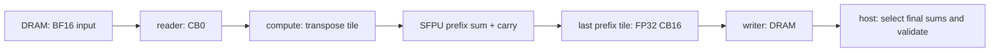

# 22. 단일 코어 Row-wise Reduction

상태: **NPU row-wise sum 구현·정확성 검증 완료**. 날짜: 2026-11-09.
[진행 순서](README.md) · 이전: [21. CUDA MatMul 비교](21-cuda-matmul-comparison.md)

## 이번 범위

BF16 입력 X[H,W]에서 각 행의 합 y[H]를 구합니다.

```text
y[h] = sum(X[h, w], w=0..W-1)
```

TTSim Wormhole의 코어 하나를 사용하며, 입력은 BF16, destination과 출력은 FP32입니다.
CUDA Reduction, 코어 사이 부분합 집계, mean/max, RMSNorm은 아직 구현하지 않았습니다.
MatMul에서 쓰던 DRAM·CB·reader/compute/writer 흐름은 유지하되, 이번에는 열 방향 누적을 다룹니다.

## 첫 구현에서 발견한 수치 문제

처음에는 공식 `reduce_init/reduce_tile<PoolType::SUM, REDUCE_ROW>`를 사용했습니다.
작은 정수와 257·8200 같은 FP32 출력 검증은 통과했지만, 상쇄 사례가 실패했습니다.

| 경로 | 입력 사례 | FP64 기준 | 실제 출력 |
| --- | --- | --- | --- |
| BF16 입력·HiFi4 native reduce | 4096,1,-4096 반복, W=1025 | 4438 | 4097 |
| BF16 입력·LoFi native reduce | 4096,1,-4096 | 1 | 0 |
| FP32 저장·HiFi4 native reduce | 4096,1,-4096 | 1 | 0 |

모두 fp32_dest_acc_en=true와 FP32 출력을 사용했습니다.
한 타일 안에서도 문제가 재현됐고 입력 저장 형식만 바꿔서는 해결되지 않았습니다.
고정된 TT-Metal/TTSim 조합에서 관찰한 결과이며, 내부 반올림 원인이나 실제 칩에서도
같은 결과가 나오는지까지 확정한 것은 아닙니다. 실패 로그와 당시 소스를 보존했습니다.

허용오차를 넓히거나 상쇄 입력을 빼는 대신, 최종 기준 구현을 SFPU 누적합 경로로 바꿨습니다.
같은 상쇄 입력을 더 작은 폭 3·32에서도 검사했고 모두 정수 exact 검증에 포함했습니다.

## 최종 데이터 흐름

공식 cumsum 테스트의 row-wise 전치 경로를 참고했습니다.
32×32 입력 타일을 장치에서 전치한 뒤, `cumsum_tile`로 위에서 아래로 누적합니다.
원래 입력의 열 방향이 전치 후 행 방향이므로 마지막 prefix가 원래 행의 합입니다.
host에서 합을 다시 계산해 장치 출력처럼 사용하는 방식이 아닙니다.



1. reader는 행/열 타일 순서대로 입력을 한 번씩 읽습니다.
2. compute는 BF16 타일을 전치해 FP32 destination에 놓습니다.
3. 열 타일의 처음에는 carry를 초기화하고 다음 타일에는 앞선 타일의 누적합을 이어갑니다.
4. 각 타일에서 destination의 acquire/commit/wait/release 순서를 지킵니다.
5. 마지막 열 타일에서만 FP32 결과를 CB16에 pack하고 writer가 DRAM으로 보냅니다.

열 타일 사이에는 SFPU carry가 유지되며, 중간 결과를 BF16으로 pack하지 않습니다.
입력 행이 32개 늘어나 다음 row group으로 넘어갈 때 carry를 다시 초기화합니다.
CB depth1/2는 동시에 보관할 수 있는 타일 수를 바꿉니다. 실행 중첩이나 실물 속도 향상을 증명한 것은 아닙니다.

## 출력 배치와 메모리 비용

논리 출력은 H개의 FP32 값입니다. 현재 DRAM에는 row group마다 마지막 32×32 prefix 타일을 저장합니다.
장치 출력의 마지막 row 31이 원래 입력 32개 행의 최종 합이며, host는 이 위치를 읽어 row_sums를 만듭니다.
나머지 원소도 마지막 입력 타일 안의 prefix로 검증합니다.
출력은 아직 H개 값으로 압축하지 않아 논리 벡터보다 전송량이 큽니다.

H/W를 32의 배수로 0-padding합니다. 실제 H 바깥의 출력 lane은 0이어야 합니다.
W 바깥의 0을 더한 prefix는 마지막 유효 합과 같아야 하며, padding prefix 전체를 0으로 요구하지 않습니다.

| 항목 | source-derived 모델 |
| --- | --- |
| Ht / Wt | ceil(H/32) / ceil(W/32) |
| input read | Ht×Wt 타일, 타일당 2048 bytes |
| transpose / cumsum 호출 | 각각 Ht×Wt |
| output write | Ht 타일, 타일당 4096 bytes |
| CB 메모리 | depth×(2048+4096) bytes |
| destination slot | 한 타일 |
| scaler / 중간 pack | 없음 |

depth1은 6KiB, depth2는 12KiB입니다.
W가 4097로 늘어도 CB 용량은 그대로이며 입력 DRAM·전송량은 W에 따라 늘어납니다.
이 수치는 CB payload 용량이고 전체 L1 사용량·실제 DRAM traffic counter는 아닙니다.

scan은 필요한 최종 합뿐 아니라 prefix도 계산하므로, native reduce보다 계산량이 적다고 주장하지 않습니다.
지금은 수치 검증을 통과한 기준 구현을 확보하는 단계입니다.

## 검증 결과

입력 25종 × CB depth1/2 = **50개 구성**을 검사했습니다.
구성마다 동일 workload를 3회 다시 제출해 **150회 dispatch**, 사전 점검 2회를 별도로 실행했습니다.
매번 NaN sentinel로 출력을 재설정하고 마지막 prefix 타일 전체를 검사했습니다.
입력 배치는 공식 tilize_nfaces와 대조했고, CB 깊이 사이 입력·출력 fingerprint도 일치했습니다.

| 사례 | 확인할 내용 |
| --- | --- |
| 2×3 deterministic | [1,2,3]과 [4,5,6]의 합이 [6,15] |
| zero / signed random | 0, 음수, 행별 합, padding |
| H=1,31,32,33,65 | face/타일 경계와 여러 row group, carry 초기화 |
| W=1,31,32,33,257,1025,4097 | 열 타일 경계와 여러 타일의 carry |
| ones / large_exact | 257,4097,8200을 FP32로 보존 |
| cancellation, W=3,32,1025 | 작은 항이 섞인 상쇄, 양수/음수 행 |
| fractional | BF16 양자화 입력의 FP64 합과 오차 비교 |

정수 사례는 오차 0을 요구했고 모두 통과했습니다.
소수 허용오차는 처음 정한 atol=1e-4, rtol=1e-5를 유지했습니다.
마지막 prefix 타일 전체의 최대 절대 오차는 **4.768371582e-07**였습니다.
mean_abs_error는 논리 행 합에 대한 값이며, max_abs_error는 검사한 전체 prefix의 최대값입니다.

## 실행과 코드 읽는 순서

```bash
cd /home/ysjun5656/dev/accelflow
bash scripts/run_reduction.sh
```

기존 TT-Metal build tree의 host interface를 읽어 자체 host executable만 빌드합니다.
새 TT-Metal clone·전체 빌드·드라이버 설치는 하지 않습니다.
재실행 횟수는 `bash scripts/run_reduction.sh --repeats 1`로 바꿀 수 있습니다.

코드는 다음 순서로 읽으면 됩니다.

1. `npu/reduction/reduction.cpp`: 입력 생성·pack·CB/커널 구성·CPU 검증
2. `npu/reduction/kernels/reader.cpp`: DRAM→CB0
3. `npu/reduction/kernels/compute.cpp`: transpose·SFPU scan·carry·마지막 pack
4. `npu/reduction/kernels/writer.cpp`: CB16→DRAM

host의 row_sums 추출은 `group*1024 + offset(31, lane, 32)` 위치를 선택합니다.
selector를 쓰면 한 사례만 검사할 수 있습니다. 아래 명령은 runner가 구성하는 공식 simulator 환경 안에서 사용합니다.

```text
reduction report.json depth:1|2 [repeats:1..5] [name:H,W]
```

## 결과와 참고 자료

- [검증 요약](../results/reduction/20261109T084724728270Z/summary.json)
- [실행 명령·환경·소스/실행 파일 SHA256](../results/reduction/20261109T084724728270Z/metadata.json)
- [최종 전체 로그](../results/reduction/20261109T084724728270Z/runner.log)
- [첫 BF16/HiFi4 실패 기록](../results/reduction/20261109T083735099365Z/metadata.json)
- [BF16/LoFi 점검](../results/reduction/20261109T084129143994Z/metadata.json)
- [FP32 저장 점검](../results/reduction/20261109T084316865240Z/metadata.json)
- [공식 cumsum API](https://github.com/tenstorrent/tt-metal/blob/de546d3b146758714d900f11b218c8f9c805f410/tt_metal/hw/inc/api/compute/cumsum.h)
- [참고한 row-wise cumsum 테스트](https://github.com/tenstorrent/tt-metal/blob/de546d3b146758714d900f11b218c8f9c805f410/tests/tt_metal/tt_metal/test_kernels/compute/cumsum.cpp)
- [처음 확인한 reduce API](https://github.com/tenstorrent/tt-metal/blob/de546d3b146758714d900f11b218c8f9c805f410/tt_metal/hw/inc/api/compute/reduce.h)

실제 NPU 성능은 측정하지 않았습니다. metadata의 process_wall_seconds는 초기화·JIT·CPU 검사까지 포함한 실행 기록입니다.
다음은 같은 입력을 사용하는 CUDA row-wise sum과 비교하고, 이후 코어 간 부분합 집계 또는 RMSNorm으로 확장하는 단계입니다.

후속 CUDA row-wise sum 3개 구현과 동일 입력 대조는 [24번](24-cuda-reduction.md)에서 완료했습니다.
