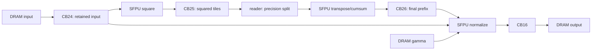

# 26. NPU RMSNorm Fusion

상태: **단일 코어 fused 프로그램·기준 출력·PyTorch 대조 완료**. 날짜: 2026-11-10.
[진행 순서](README.md) · 이전: [25. RMSNorm 기준 구현](25-rmsnorm.md)

## 바뀐 실행 흐름

기존 RMSNorm은 제곱, 제곱합, 정규화를 별도 프로그램으로 제출했다.
제곱 타일과 행별 제곱합 prefix를 DRAM에 저장한 뒤 다음 프로그램에서 읽었다.
새 `fused` 경로는 이 세 계산을 한 프로그램 안에서 이어 실행한다.
입력과 제곱 타일은 L1 CB에 보관하고 DRAM에는 입력·gamma·최종 출력만 둔다.
기존 경로와 CLI 기본값은 `unfused`로 유지했다.



reader, compute, writer 커널이 한 프로그램에서 CB로 협력한다.
compute 커널의 `square_row → sum_row → normalize_row`가 32개 행의 묶음을 처리한다.
각 계산 단계 사이에서 host로 값을 읽거나 다음 프로그램을 제출하지 않는다.
이를 전체 행을 DST에 유지하는 구현이나 multicore 구현으로 해석하지 않는다.

## CB 수명과 동기화

| CB | producer | pop하는 consumer | 보관 범위 |
| --- | --- | --- | --- |
| 24 | reader | compute UNPACK | 원본 row group, 정규화가 끝날 때까지 유지 |
| 25 | compute PACK | reader | 제곱 row group, 두 scan 입력을 만들 때까지 유지 |
| 26 | compute PACK | reader | 마지막 prefix, 정규화 입력 준비가 끝날 때까지 유지 |
| 0/1/2/4/5 | reader | compute UNPACK | scan·정규화에 필요한 streaming operand |
| 16 | compute PACK | writer | 최종 출력 타일 |

CB24/25의 용량은 각각 한 row group의 전체 폭이다. 전체 용량을 reserve/pop하므로
다음 row group에서 포인터가 base로 돌아간다. 각 CB의 write/read 포인터는 지정된 producer와
consumer 하나씩만 갱신한다. 원본을 정규화에서 다시 쓸 때는 CB24의 L1 보관본을 복사한다.
gamma는 출력 타일마다 DRAM에서 읽으며 두 row group을 겹쳐 실행하지 않는다.

제곱합의 hi/low 두 scan과 통계값의 hi/middle/low 재구성은 25번의 정밀도 전달 방식을 유지했다.
cumsum carry가 살아 있는 동안 다른 SFPU 연산을 끼우지 않는다.
모든 산술 연산은 compute engine에서 수행하며 RISC-V reader는 비트 분할과 배치를 맡는다.

공식 API의 [CB 수명·포인터 규칙](https://github.com/tenstorrent/tt-metal/blob/de546d3b146758714d900f11b218c8f9c805f410/tt_metal/hw/inc/api/compute/cb_api.h)을 확인했다.

## 정확성 검증

25번에서 사용한 BF16 입력·gamma·epsilon fixture를 다시 생성하고 SHA-256이 같음을 확인했다.
입력 값과 gamma는 FP32로 확장하고 누적·출력도 FP32로 유지했다.
기존 `atol=1e-4`, `rtol=1e-4`를 바꾸지 않았다.

- 공통 입력 20종 × CB depth1/2 = **40개 구성**, 각각 2회로 **80회 fused 제출**을 통과했다.
- fused pilot 2회와 기존 unfused 경로의 회귀 pilot 2회를 별도로 통과했다.
- 유효 출력은 NaN sentinel로 초기화하고 결과 전체와 padding을 검사했다.
  반복 제출 결과와 depth 사이 결과도 같아야 통과한다.
- 40개 구성의 저장된 fused 출력은 3-stage NPU 기준 출력과 **비트 단위로 일치**했다.
- PyTorch FP32·FP64 기준과 fused/unfused NPU 및 저장된 CUDA 출력 120개를 다시 대조했다.

fused의 CPU FP64 기준 최대 절대 오차는 2.33068715882e-07였다.
PyTorch FP32 대비 최대 절대 오차는 2.38418579102e-07,
PyTorch FP64 대비는 2.33068715882e-07였다.

fused는 중간 DRAM buffer를 만들지 않아 제곱·prefix를 host로 읽어 검사하지 않는다.
그 대신 전체 출력의 CPU/PyTorch 대조와 기존 경로의 bitwise 일치를 검사했다.
검증 범위는 저장된 유한 BF16 입력 corpus다. 임의의 NaN/Inf/subnormal 입력이나 backward는 포함하지 않는다.

## DRAM 감소와 L1 비용

`Ht=(H+31)//32`, `Wt=(W+31)//32`, `T=Ht*Wt`로 두면 다음과 같다.

| 항목 | 기존 3-stage | fused |
| --- | --- | --- |
| operator당 프로그램 제출 | 3회 | 1회 |
| 중간 DRAM capacity | `(T+Ht)*4096` bytes | 0 bytes |
| DRAM payload 모델 | `(7*T+2*Ht)*4096` bytes | `3*T*4096` bytes |
| CB peak payload | `(6*depth+1)*4096` bytes | `(2*Wt+6*depth+1)*4096` bytes |

DRAM 모델은 실제 데이터 이동 코드의 input·gamma 읽기와 output 쓰기에서 계산했다.
기존 squared 입력 두 pass와 prefix 저장·읽기가 DRAM에서 사라진다.
L1 안의 복사, broadcast, 정밀도 분할, 두 번의 scan은 여전히 수행한다.
이 수치는 hardware counter나 실제 대역폭 측정값이 아니다.

아래는 depth 2의 대표 입력이다. payload 단위는 bytes다.

| H×W | 기존 DRAM payload | fused DRAM payload | 감소율 | fused CB payload |
| --- | --- | --- | --- | --- |
| 2×33 | 65536 | 24576 | 62.50% | 68 KiB |
| 3×257 | 266240 | 110592 | 58.46% | 124 KiB |
| 2×1025 | 954368 | 405504 | 57.51% | 316 KiB |
| 1×4097 | 3706880 | 1585152 | 57.24% | 1084 KiB |

폭 4097의 CB payload는 1110016 bytes, 즉 **1084 KiB**다.
기존 peak 52 KiB보다 크게 늘었으며 code·stack·runtime L1 할당은 이 수치에 포함하지 않았다.
device API가 보고한 core당 L1 크기는 1499136 bytes다. 실제 CB 할당과 실행도 이 범위에서 통과했다.

이번 경로는 **W <= 4097**로 제한한다. 폭 8193은 두 row cache만으로도 L1 용량을 넘으므로
data buffer 할당 전에 명시적인 오류로 거절한다. 이 resource guard도 검사했다.
추가로 CB payload 상한 1200 KiB를 확인한다. 더 넓은 입력은 chunking·재읽기 등 다른 설계가 필요하다.

## 성능 해석

이번에 확인한 성과는 중간 DRAM 제거, 프로그램 제출 감소, 같은 출력과 그에 따른 L1 비용이다.
TTSim의 process wall time은 metadata에 남겼지만 JIT·초기화·검증·시뮬레이터 실행 비용을 포함한다.
이를 실제 NPU 속도나 fusion의 실물 배율로 사용하지 않는다.
현재 reader는 scalar L1 복사와 통계 broadcast를 사용하며 NoC 전송을 줄였다고 해서
전체 실행 비용이 반드시 줄어든다고 주장하지 않는다.

## 재현과 자료

```bash
cd /home/ysjun5656/dev/accelflow
bash scripts/run_rmsnorm_fused.sh

# 위 명령이 출력한 새 결과 경로로 지정한다.
.venv/bin/python tools/report/audit_rmsnorm_fused.py \
  --results results/rmsnorm_fused/20261110T051656706592Z
```

PyTorch CPU 환경은 `requirements-pytorch-reference.txt`를 사용한다.
기존 경로만 실행하는 `bash scripts/run_rmsnorm.sh`의 기본 동작은 유지된다.
직접 실행할 때 마지막 인자로 `fused` 또는 `unfused`를 지정할 수 있다.

- [fused compute](../npu/rmsnorm/kernels/fused_compute.cpp) · [fused reader](../npu/rmsnorm/kernels/fused_reader.cpp)
- [host·CB 구성](../npu/rmsnorm/rmsnorm.cpp) · [CB 소유권 안내](../npu/rmsnorm/README.md)
- [실행 script](../tools/report/run_rmsnorm_fused.py) · [PyTorch 대조](../tools/report/audit_rmsnorm_fused.py)
- [검증·모델 요약](../results/rmsnorm_fused/20261110T051656706592Z/summary.json)
- [명령·종료 코드·source/실행 파일 hash·wall time](../results/rmsnorm_fused/20261110T051656706592Z/metadata.json)
- [PyTorch 결과](../results/rmsnorm_fused/20261110T051656706592Z/pytorch-audit.json)
- [전체 depth1 로그](../results/rmsnorm_fused/20261110T051656706592Z/fused-depth1.log)
- [전체 depth2 로그](../results/rmsnorm_fused/20261110T051656706592Z/fused-depth2.log)
- [폭 제한 확인](../results/rmsnorm_fused/20261110T051656706592Z/width-resource-guard.log)

다음 후보는 코어마다 다른 행을 맡기는 multicore RMSNorm과 TT-NN 기준 구현 대조다.
이번 단계는 단일 코어이며 코어 간 부분합 교환은 구현하지 않았다.

후속 행 분할 1·2·4코어 RMSNorm은 [27번](27-multicore-rmsnorm.md)에서 검증했습니다.
