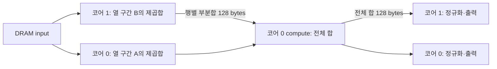

# 28. 열 분할 RMSNorm과 코어 간 부분합 교환

상태: **열 분할 1·2·4코어, 행 분할 대조, PyTorch 검증 완료**. 날짜: 2026-11-10.
[진행 순서](README.md) · 이전: [27. 행 분할](27-multicore-rmsnorm.md) · 다음: [29. Metalium 결과 정리](29-metalium-results.md)

## 행을 나눌 때와 열을 나눌 때

기존 `fused`는 서로 다른 32행 묶음을 코어에 배정했다. 각 코어가 한 행의 전체 열을 갖고 있어
제곱합을 다른 코어와 교환할 필요가 없었다. H=1이면 열이 길어도 활성 코어는 하나다.
새 `column`은 한 행의 타일 열을 연속 구간으로 나눈다. 각 코어가 자기 입력을 제곱·누적한 뒤
대표 코어가 부분합을 더하고 전체 합을 돌려준다. 정규화와 출력 저장은 각 구간의 코어가 맡는다.



그림은 2코어 사례다. 4코어에서도 rank 0으로 모았다가 각 worker에 unicast로 전달한다.
트리 reduction이나 NoC multicast를 사용한 all-reduce는 아니다. 입력·gamma는 BF16 비트를
FP32로 확장하고 출력·누적은 FP32다. 평균의 분모는 padding 폭이 아닌 원래 W다.

## 장치 실행과 동기화

각 코어의 reader가 자기 열의 입력을 CB24에 보관하고 compute가 제곱을 CB25에 쓴다.
기존 hi/low scan으로 만든 부분합 prefix는 CB26에 놓인다. reader는 여기서 32개 행의
마지막 prefix만 뽑아 128 bytes로 모은다. 부동소수점 덧셈은 reader나 host에서 하지 않는다.

worker는 valid semaphore를 0으로 만든 뒤 부분합을 leader L1 mailbox에 쓴다.
`noc_async_write_barrier()` 후 ready를 증가시키므로 leader가 미완료 데이터를 읽지 않는다.
leader는 모든 worker의 ready를 기다리고 0으로 되돌린다. 부분합의 hi/middle/low 조각을
compute에 전달하면 compute가 FP32로 재구성해 rank 순서대로 더하고 CB27에 전체 합을 쓴다.
leader reader는 이 값을 128 bytes로 모아 worker에 쓴 뒤 write barrier와 valid 신호를 보낸다.

worker는 전체 합을 받은 뒤 자기 입력·gamma를 곱해 출력한다. 다음 행의 ready를 보낼 때는
이전 행의 전체 합을 모두 읽은 상태다. 다음 gather가 이전 global mailbox의 재사용 허가 역할도 한다.
부분합 slot은 rank마다 달라 서로 덮어쓰지 않는다. 모든 코어의 CB28과 semaphore는 같은
core range에 먼저 할당해 L1 주소를 맞췄고 크기가 다른 입력·제곱 cache는 그 뒤에 할당했다.
CB28은 4096-byte raw mailbox로 한 번 reserve하며 compute 스트림의 push/pop에는 사용하지 않는다.
사용하는 mailbox 영역은 `128*(P+1)` bytes다.

공식 v0.79.0의 [CreateSemaphore](https://github.com/tenstorrent/tt-metal/blob/v0.79.0/tt_metal/api/tt-metalium/host_api.hpp)와
[NoC·semaphore API](https://github.com/tenstorrent/tt-metal/blob/v0.79.0/tt_metal/hw/inc/api/dataflow/dataflow_api.h),
프로젝트의 기존 MatMul ready/data/valid 경로를 확인했다. 데이터 이동과 통계 덧셈은 모두 장치에서 수행한다.

## 검증 결과

같은 7개 BF16 fixture를 행 분할과 열 분할의 요청 코어 1·2·4에서 실행했다.
CB depth2의 42개 구성과 열 분할 4코어 depth1의 7개 구성을 합쳐 **49개 구성**이다.
pilot와 반복 제출을 포함한 본 검증은 **67회 제출**을 통과했다.
동일 반복 횟수의 시간 대조 7회와 기존 unfused 회귀 2회를 더해 이번 실행은 **76회 제출**이다.

입력은 zero 1×1, signed 17×33, fractional 33×129, remote-spike 33×257,
mixed-magnitude 65×65, wide 1×1025, small-input/epsilon 1×31이다.
gamma는 음수·0·양수를 포함한다. epsilon은 저장된 FP32의 1e-6·1e-5·1e-3을 사용한다.
remote-spike는 마지막 열에 32, 나머지 열에 1을 두어 다른 코어의 큰 제곱합이
leader와 나머지 출력 구간의 정규화에 반영되는지 검사한다.

모든 실행에서 NaN으로 초기화한 출력 전체, 유효 영역의 CPU FP64 오차, padding 0을 확인했다.
반복 제출은 출력 값의 동일성을 검사한다. Python에서는 열 타일 coverage·출력 소유권,
idle core 제외, CB·DRAM·통신 모델을 독립적으로 검사했다.
PyTorch FP32·FP64 RMSNorm 기준과 저장된 **49개 출력**도 대조했다.

| 비교 | 최대 절대 오차 |
| --- | --- |
| CPU FP64 기준 | 2.22544938255e-07 |
| PyTorch FP32 기준 | 2.38418579102e-07 |
| PyTorch FP64 기준 | 2.22544938255e-07 |
| 행 분할 단일 코어 출력과의 차이 | 2.38418579102e-07 |

허용 오차는 기존 `atol=1e-4`, `rtol=1e-4`를 유지했다. 열 분할은 합산 순서가 바뀌므로
기존 출력과 bitwise 일치를 필수 조건으로 삼지 않는다. NaN/Inf/subnormal 전체 범위,
backward, 여러 장치 간 통신은 검증하지 않았다. 기존 unfused 회귀는 2개 fixture만 다시 실행했다.
이전 MatMul·CUDA 실험 전체를 이번에 재실행한 것은 아니다.

## L1과 통신 비용

`Ht=ceil(H/32)`, `Wt=ceil(W/32)`, `P=min(요청 코어,Wt)`다.
열 분할 코어 i가 맡은 타일 열 수를 Wi, CB depth를 d로 두면 CB payload는 다음과 같다.

| 항목 | 행 분할 fused | 열 분할 column |
| --- | --- | --- |
| 활성 코어 | min(요청 코어,Ht) | min(요청 코어,Wt) |
| 코어당 CB bytes | `4096*(2*Wt+6*d+1)` | `4096*(2*Wi+6*d+3)` |
| 전체 CB bytes | 코어당 값 × 활성 코어 | `4096*(2*Wt+P*(6*d+3))` |
| 중간 DRAM buffer | 0 | 0 |
| DRAM 요청 payload | `3*Ht*Wt*4096` | 동일 |
| peer 통계 payload | 0 | `256*Ht*(P-1)` bytes |
| peer data write / atomic inc 호출 | 0 / 0 | 각각 `2*Ht*(P-1)` |

NoC payload는 partial과 global 각 128 bytes의 합이다. atomic packet·protocol overhead는 포함하지 않는다.
위 표는 소스 기반 모델이며 hardware counter 측정값이 아니다. CB 외의 code·stack·semaphore와
전체 L1 allocator 사용량도 포함하지 않는다. gamma caching과 DRAM load/compute 중첩은 구현하지 않았다.

요청 코어 4, depth2 조건의 실제 배정과 모델은 다음과 같다. CB 단위는 KiB다.

| H×W | 행 분할 활성 | 열 분할 활성 | 코어별 타일 열 수 | 최대 코어 CB 행/열 | 전체 CB 행/열 | peer bytes |
| --- | --- | --- | --- | --- | --- | --- |
| 1×1 | 1 | 1 | 1 | 60 / 68 | 60 / 68 | 0 |
| 17×33 | 1 | 2 | 1/1 | 68 / 68 | 68 / 136 | 256 |
| 33×129 | 2 | 4 | 2/1/1/1 | 92 / 76 | 184 / 280 | 1536 |
| 33×257 | 2 | 4 | 3/2/2/2 | 124 / 84 | 248 / 312 | 1536 |
| 65×65 | 3 | 3 | 1/1/1 | 76 / 68 | 228 / 204 | 1536 |
| 1×1025 | 1 | 4 | 9/8/8/8 | 316 / 132 | 316 / 504 | 768 |
| 1×31 | 1 | 1 | 1 | 60 / 68 | 60 / 68 | 0 |

1×1025는 행 분할에서 1코어, 열 분할에서 4코어를 사용한다. 열 분할로 코어당 cache가 줄지만
mailbox·streaming CB가 복제돼 전체 L1 비용은 늘어난다. 65×65에서는 두 방식 모두 3코어를 사용한다.
열 분할은 별도의 동기화와 leader 집계를 추가하므로 입력 shape에 따라 선택해야 한다.

## TTSim 관측 시간

아래는 같은 7개 입력을 각 1회 제출한 depth2 process 하나씩의 `perf_counter` 시간이다.
4코어 열 분할은 반복 검증과 분리해 `column4-once`를 추가 실행했다. 단위는 seconds다.

| 요청 코어 | 행 분할 전체 process | 열 분할 전체 process |
| --- | --- | --- |
| 1 | 69.172 | 50.787 |
| 2 | 68.842 | 39.857 |
| 4 | 61.691 | 33.409 |

초기화·JIT·host 검증까지 포함하며 process별 반복 통계를 수집하지 않았다. 실행 순서와 JIT/cache
상태도 통제하지 않았다. 따라서 이 표는 이번 simulator 실행 비용 기록이며 실제 NPU의 가속 비율,
코어 간 통신 지연, DRAM bandwidth나 커널 자체의 순수 지연으로 해석하지 않는다.
leader의 직렬 집계와 row group마다의 ready/valid 교환은 실물에서 별도 측정할 최적화 후보다.

## 재현과 근거

```bash
cd /home/ysjun5656/dev/accelflow
bash scripts/run_rmsnorm_column.sh
# 위 명령이 출력한 새 RESULTS 경로를 전달
.venv/bin/python tools/report/audit_rmsnorm_column.py --results <RESULTS>
```

host CLI는 `rmsnorm list.txt report.json depth repeats [unfused|fused|column] [cores]`다.
생략 시 기존 unfused/1코어를 유지한다. column은 W<=4097, 요청 코어 1·2·4,
단일 장치·논리 코어 한 행을 지원한다. 1200 KiB의 보수적 코어당 CB 상한을 유지했다.
현재 열 분할로 실제 실행한 폭은 1·31·33·65·129·257·1025이며 상한 전체를 검사한 것은 아니다.
TT-Metal v0.79.0과 TTSim v1.11.1을 그대로 사용했고 의존성 설치나 전체 TT-Metal 재빌드는 하지 않았다.

- [host 분할·metadata](../npu/rmsnorm/rmsnorm.cpp), [프로그램·CB·semaphore 구성](../npu/rmsnorm/column_sharded.hpp)
- [reader·NoC 통신](../npu/rmsnorm/kernels/column_reader.cpp), [compute·통계 집계](../npu/rmsnorm/kernels/column_compute.cpp), [writer](../npu/rmsnorm/kernels/column_writer.cpp)
- [실행·모델 검증](../tools/report/run_rmsnorm_column.py), [PyTorch 독립 대조](../tools/report/audit_rmsnorm_column.py)
- [summary](../results/rmsnorm_column/20261110T083909207924Z/summary.json), [명령·버전·SHA-256·시간](../results/rmsnorm_column/20261110T083909207924Z/metadata.json)
- [PyTorch 결과](../results/rmsnorm_column/20261110T083909207924Z/pytorch-audit.json), [시간 대조·unfused 회귀](../results/rmsnorm_column/20261110T083909207924Z/followup-checks.json)
- [4코어 depth1 로그](../results/rmsnorm_column/20261110T083909207924Z/column4-depth1.log)
